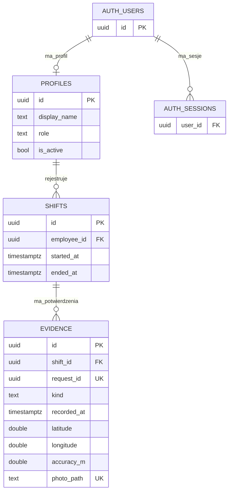

# Model danych Takt

Jeden projekt Supabase obsługuje jeden zespół. Supabase Auth przechowuje konta, hasła i sesje w schemacie `auth`. Profil aplikacji używa tego samego identyfikatora UUID. Blokada konta w Takt jest zapisana w `profiles.is_active`, dzięki czemu uprawnienia do danych wygasają także dla wcześniej wydanego tokenu sesji.

Zdjęcia JPEG mają trafić do prywatnego zasobnika `takt-evidence`. Pole `evidence.photo_path` wskazuje plik. Polityka odczytu Storage wymaga widocznego powiązania w `evidence`, dlatego przypadkowy lub niepowiązany plik nie jest dostępny dla aplikacji.

| Dane | Aktywny pracownik | Aktywny administrator |
| --- | --- | --- |
| Profile | Własny profil | Profile całego zespołu, włącznie z zablokowanymi |
| Zmiany i metadane | Własne zmiany i potwierdzenia | Zmiany i potwierdzenia całego zespołu |
| Zdjęcia | Pliki powiązane z własnymi potwierdzeniami | Pliki powiązane z potwierdzeniami zespołu |

Pierwsza migracja nadaje przeglądarce odczyt zgodny z RLS. Operacje zapisu powstaną osobno po stronie serwera. Unikatowy indeks ogranicza konto do jednej otwartej zmiany. Klucz `request_id` zabezpiecza ponowienie, a ograniczenie `(shift_id, kind)` dopuszcza najwyżej jedno potwierdzenie rozpoczęcia i jedno zakończenia na zmianę. Czasy są przechowywane jako `timestamptz`. Interfejs i raport mają je prezentować w strefie `Europe/Warsaw`.
