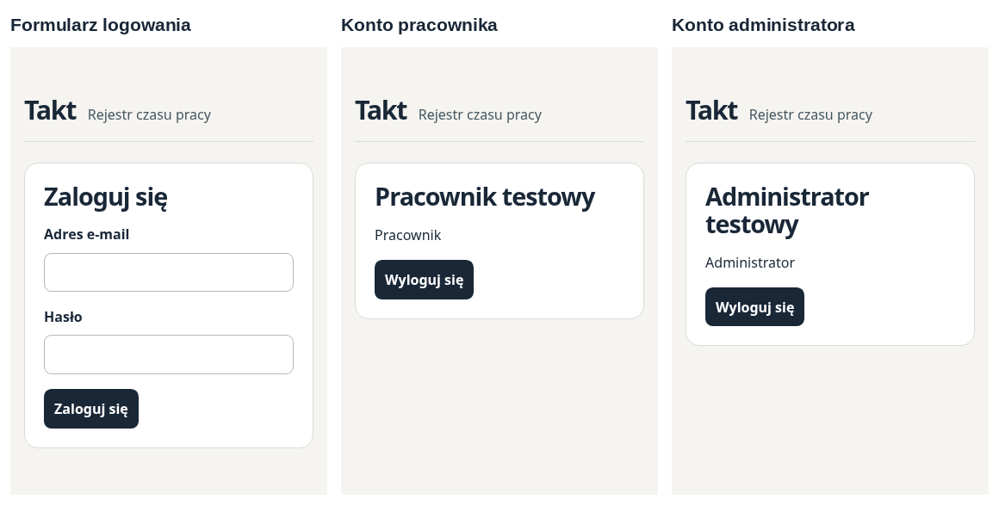
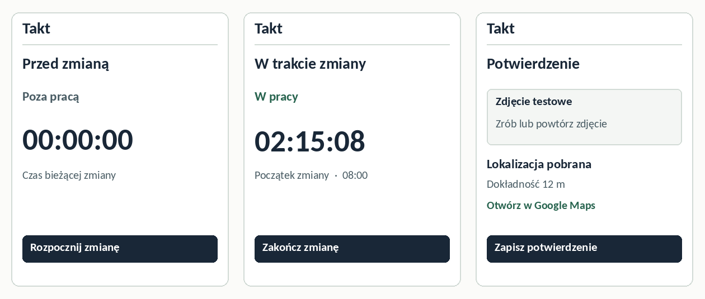

# Widoki i operacje Takt

## Logowanie z tygodnia 1

Pracownik i administrator logują się e-mailem i hasłem. Po pobraniu aktywnego profilu aplikacja wyświetla nazwę i rolę. Przycisk wylogowania kończy sesję na bieżącym urządzeniu.

Zrzuty pochodzą z demonstracji z 26 listopada 2026 r. W obu sesjach po odświeżeniu strony nadal wyświetlał się właściwy profil. To samo zapytanie do tabeli profili zwróciło pracownikowi jeden wiersz, a administratorowi dwa. Po wylogowaniu i ponownym otwarciu strony oba konta zobaczyły formularz logowania. Po wyłączeniu samodzielnej rejestracji Supabase odrzucił próbę utworzenia nowego konta (HTTP 422, `signup_disabled`). [Szczegóły wcześniejszych testów RLS](https://github.com/vysotzzky/takt/pull/4)

## Makiety przygotowane w tygodniu 1

### Pracownik

Na początku pracownik widzi status „Poza pracą”. Przycisk „Rozpocznij zmianę” otwiera ekran potwierdzenia. Po zapisaniu zdjęcia i lokalizacji pulpit pokazuje czas rozpoczęcia, licznik i przycisk zakończenia. Zakończenie zmiany wymaga drugiego potwierdzenia. W razie utraty sieci ekran pozwoli ponowić zapis tego samego zdarzenia.

### Administrator

Historia pozwoli wybrać miesiąc i pracownika, otworzyć szczegóły potwierdzenia oraz pobrać CSV. Miejsce zdarzenia otworzy się z linku do Google Maps. W widoku zespołu administrator będzie mógł utworzyć i edytować konto, zablokować je, przywrócić dostęp lub rozpocząć reset hasła.

## Operacje dostępne w tygodniu 1

| Operacja | Interfejs | Wynik |
| --- | --- | --- |
| Logowanie | Supabase Auth, `signInWithPassword` | Sesja użytkownika po podaniu prawidłowego e-maila i hasła. |
| Odtworzenie sesji | Supabase Auth, `getSession`, następnie odczyt profilu | Po odświeżeniu wraca widok aktywnego konta. |
| Pobranie profilu | Data API, `GET /rest/v1/profiles` | Aplikacja wybiera bieżący profil. RLS ogranicza także zapytania bez filtra po użytkowniku. |
| Wylogowanie | Supabase Auth, `signOut({ scope: "local" })` | Powrót do formularza logowania na bieżącym urządzeniu. |

## Rejestracja zmiany w tygodniu 2

| Operacja | Interfejs | Wynik |
| --- | --- | --- |
| Odczyt ostatniej zmiany | Data API, shifts z powiązanymi evidence | Status, licznik, godziny i linki do Google Maps pozostają dostępne po odświeżeniu strony. |
| Zdjęcie | Przeglądarka, getUserMedia | Po kliknięciu aparatu pracownik zatwierdza pojedynczą klatkę JPEG. Ścieżka dźwiękowa jest wyłączona. |
| Lokalizacja | Przeglądarka, getCurrentPosition | Jednorazowy odczyt szerokości, długości i deklarowanej dokładności w metrach. |
| Przesłanie zdjęcia | Supabase Storage, bucket takt-evidence | Aktywny pracownik zapisuje JPEG we własnym katalogu pod identyfikatorem zdarzenia. |
| Początek lub koniec | Data API, RPC record_shift_event | Baza sprawdza konto i zdjęcie, po czym zapisuje zmianę i potwierdzenie w jednej transakcji. Oba rekordy mają ten sam czas serwera. |
| Ponowienie | Ten sam identyfikator w otwartym formularzu | Utrata odpowiedzi z serwera pozwala ponowić ten sam zapis. Odświeżenie strony przed zakończeniem zapisu usuwa formularz. |

W trakcie testów korzystaj z fikcyjnych kont i zdjęć obiektu testowego. Wersja na komputer wymaga połączenia z Supabase. Przesłanie zdjęcia poprzedza transakcję w bazie. Jeśli po przesłaniu pliku zamkniesz formularz przed zapisem, w prywatnym zasobniku może pozostać niepowiązany plik. Trwałe ponawianie i sprzątanie takich plików należą do dalszej części etapu.

## Pozostałe operacje

| Etap | Operacja | Wynik |
| --- | --- | --- |
| 2 | Wznowienie po ponownym otwarciu aplikacji | Kolejka zachowa niezapisane potwierdzenie przy braku sieci. |
| 3 | Historia zespołu i eksport CSV | Administrator wybierze miesiąc i pracownika oraz pobierze raport. |
| 3 | Zarządzanie zespołem | Administrator utworzy lub zmieni konto, zablokuje je, przywróci dostęp lub rozpocznie reset hasła. |
