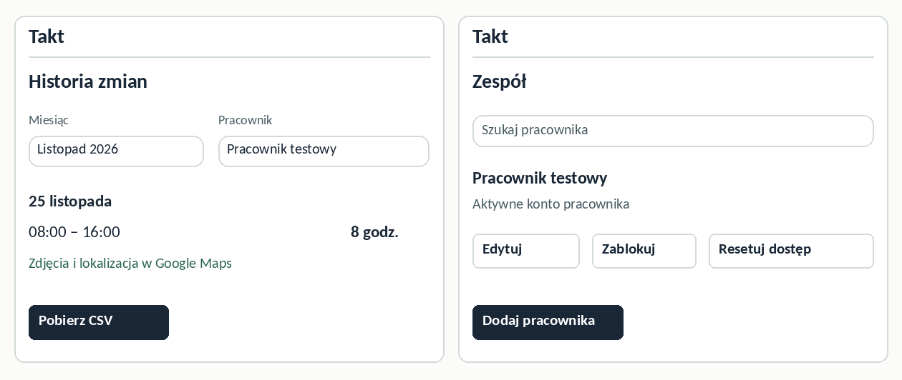

# Widoki i operacje Takt

## Działająca wersja

Pracownik i administrator logują się e-mailem i hasłem. Po pobraniu aktywnego profilu aplikacja wyświetla nazwę i rolę. Przycisk wylogowania kończy sesję na bieżącym urządzeniu.

Zrzuty pochodzą z demonstracji z 26 listopada 2026 r. W obu sesjach po odświeżeniu strony nadal wyświetlał się właściwy profil. To samo zapytanie do tabeli profili zwróciło pracownikowi jeden wiersz, a administratorowi dwa. Po wylogowaniu i ponownym otwarciu strony oba konta zobaczyły formularz logowania. Po wyłączeniu samodzielnej rejestracji Supabase odrzucił próbę utworzenia nowego konta (HTTP 422, `signup_disabled`). [Szczegóły wcześniejszych testów RLS](https://github.com/vysotzzky/takt/pull/4)

## Makiety kolejnych ekranów

### Pracownik

Na początku pracownik widzi status „Poza pracą”. Przycisk „Rozpocznij zmianę” otwiera ekran potwierdzenia. Po zapisaniu zdjęcia i lokalizacji pulpit pokazuje czas rozpoczęcia, licznik i przycisk zakończenia. Zakończenie zmiany wymaga drugiego potwierdzenia. W razie utraty sieci ekran pozwoli ponowić zapis tego samego zdarzenia.

### Administrator

Historia pozwoli wybrać miesiąc i pracownika, otworzyć szczegóły potwierdzenia oraz pobrać CSV. Miejsce zdarzenia otworzy się z linku do Google Maps. W widoku zespołu administrator będzie mógł utworzyć i edytować konto, zablokować je, przywrócić dostęp lub rozpocząć reset hasła.

## Operacje dostępne w tygodniu 1

| Operacja | Interfejs | Wynik |
| --- | --- | --- |
| Logowanie | Supabase Auth, `signInWithPassword` | Sesja użytkownika po podaniu prawidłowego e-maila i hasła. |
| Odtworzenie sesji | Supabase Auth, `getSession`, następnie odczyt profilu | Po odświeżeniu wraca widok aktywnego konta. |
| Pobranie profilu | Data API, `GET /rest/v1/profiles` | Aplikacja wybiera bieżący profil. RLS ogranicza także zapytania bez filtra po użytkowniku. |
| Wylogowanie | Supabase Auth, `signOut({ scope: "local" })` | Powrót do formularza logowania na bieżącym urządzeniu. |

## Operacje planowane

| Etap | Operacja | Wejście i wynik |
| --- | --- | --- |
| 2 | Odczyt otwartej zmiany | Identyfikator zalogowanego pracownika i filtr `ended_at IS NULL`. Wynik określi status oraz początek licznika. |
| 2 | Rozpoczęcie i zakończenie zmiany | Funkcja serwerowa przyjmie typ zdarzenia, `request_id`, zdjęcie JPEG, położenie i dokładność. Powiąże plik w prywatnym Storage z potwierdzeniem i zmianą. |
| 2 | Ponowienie zapisu | Klient zachowa identyfikator pierwszego żądania. Serwer rozpozna ponowienie po `request_id` i zwróci wynik już zapisanego zdarzenia. |
| 3 | Historia i potwierdzenia | Miesiąc i opcjonalny filtr pracownika. Po sprawdzeniu dostępu użytkownik zobaczy czas, zdjęcia i link do miejsca w Google Maps. |
| 3 | Eksport CSV | Wybrany okres i zakres pracowników. Raport uwzględni widoczność danych i strefę `Europe/Warsaw`. |
| 3 | Zarządzanie zespołem | Funkcja serwerowa sprawdzi aktywną rolę administratora przed utworzeniem konta, zmianą profilu, blokadą, przywróceniem lub resetem dostępu. |

Zmiana i potwierdzenie powinny zapisywać się w jednej transakcji PostgreSQL. Przesłanie pliku do Storage to osobna operacja, więc implementacja powinna obsłużyć nieudany zapis metadanych i usunięcie osieroconego pliku.
